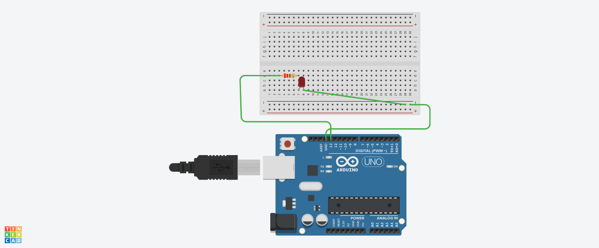

# Day 02 - LED Blink
## Goal
Blink an LED using Arduino Uno in Tinkercad simulation.
## Components
- Arduino Uno R3
- LED (any color)
- Resistor 220Ω
## Circuit
Arduino Pin 13 → Resistor 220Ω → LED (Anode) | LED (Cathode) → Arduino GND
## Code
The code turns the LED on for 1 second, then off for 1 second, repeatedly.
## What I learned
- `pinMode(pin, OUTPUT)`: set pin as output.
- `digitalWrite(pin, HIGH/LOW)`: turn on/off.
- `delay(ms)`: wait in milliseconds.
- `setup()` runs once; `loop()` runs forever.
## Simulation

